# FrameRate.

> Sua jornada pelo cinema começa aqui.

**FrameRate** é um aplicativo mobile para quem ama cinema. Nele você descobre filmes, pesquisa o catálogo, avalia o que já assistiu, monta uma lista do que quer ver e recebe lembretes para não esquecer de assistir. Os dados dos filmes vêm da API da TMDB, e contas, avaliações e listas ficam salvas no Firebase.

Projeto final desenvolvido em grupo com **React Native** e **Expo**.

## Sumário

- [Funcionalidades](#funcionalidades)
- [Telas do aplicativo](#telas-do-aplicativo)
- [Tecnologias](#tecnologias)
- [Como executar o projeto](#como-executar-o-projeto)
- [Estrutura do projeto](#estrutura-do-projeto)
- [Solução de problemas](#solução-de-problemas)
- [Divisão de tarefas e integrantes](#divisão-de-tarefas-e-integrantes)
- [Créditos](#créditos)

## Funcionalidades

- **Conta de usuário:** cadastro e login com e-mail e senha (Firebase Authentication), com a sessão mantida entre aberturas do app.
- **Descobrir:** listas de filmes em alta na semana, populares e mais bem avaliados.
- **Busca:** pesquisa por título com resultados em tempo real.
- **Detalhes do filme:** capa, nota, duração, data de lançamento, gêneros, direção, sinopse e elenco.
- **Avaliações:** nota de 1 a 5 estrelas, data em que assistiu e comentário opcional (até 500 caracteres), com opção de editar e excluir.
- **Minha Lista:** abas **Avaliados** e **Quero ver**, com filtros por gênero e por nota.
- **Lembretes:** em "Quero ver", o ícone de sino agenda uma notificação para lembrar de assistir ao filme.
- **Perfil:** foto, dados da conta e estatísticas (filmes avaliados, nota média, gênero favorito e quantidade em "Quero ver"), além de sair e excluir a conta.

## Telas do aplicativo

### Acesso

<table>
  <tr>
    <td align="center">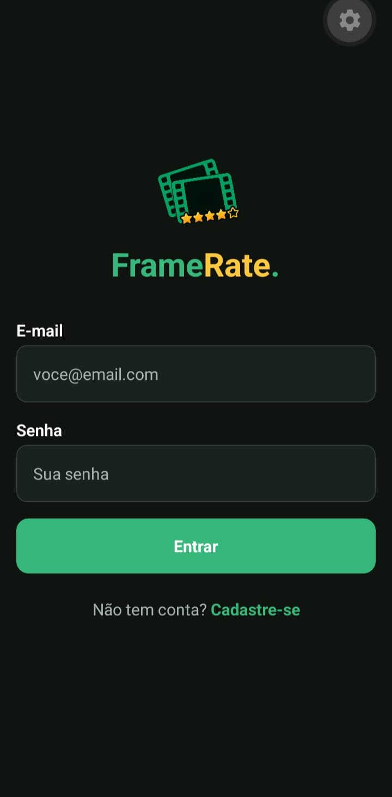<br><sub>Login</sub></td>
    <td align="center"><br><sub>Cadastro</sub></td>
  </tr>
</table>

### Busca

<table>
  <tr>
    <td align="center">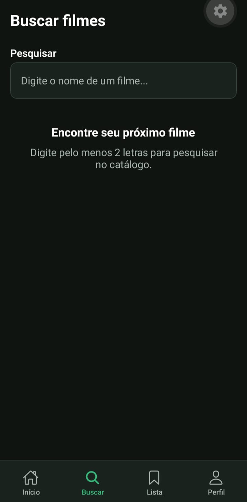<br><sub>Busca</sub></td>
    <td align="center">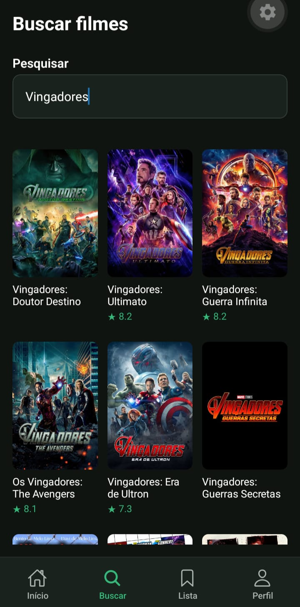<br><sub>Resultados</sub></td>
  </tr>
</table>

### Detalhes e avaliação

<table>
  <tr>
    <td align="center">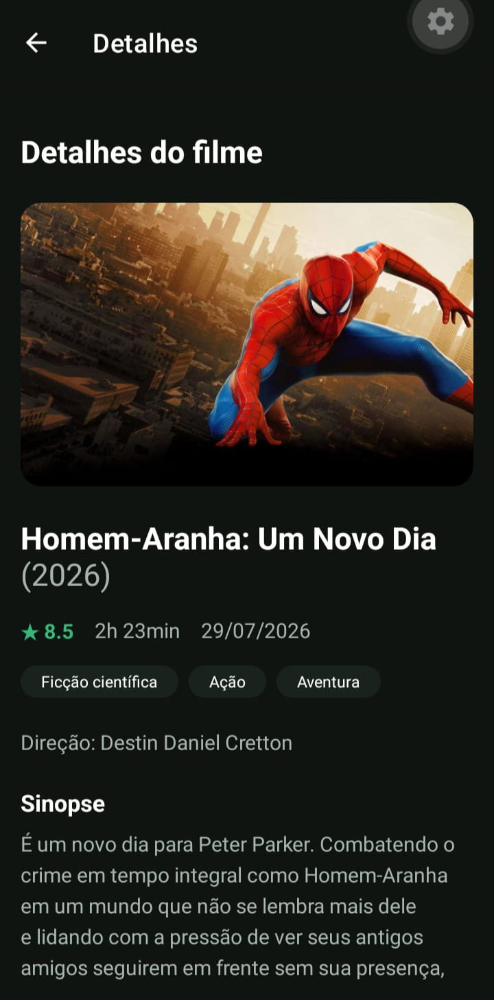<br><sub>Detalhes do filme</sub></td>
    <td align="center">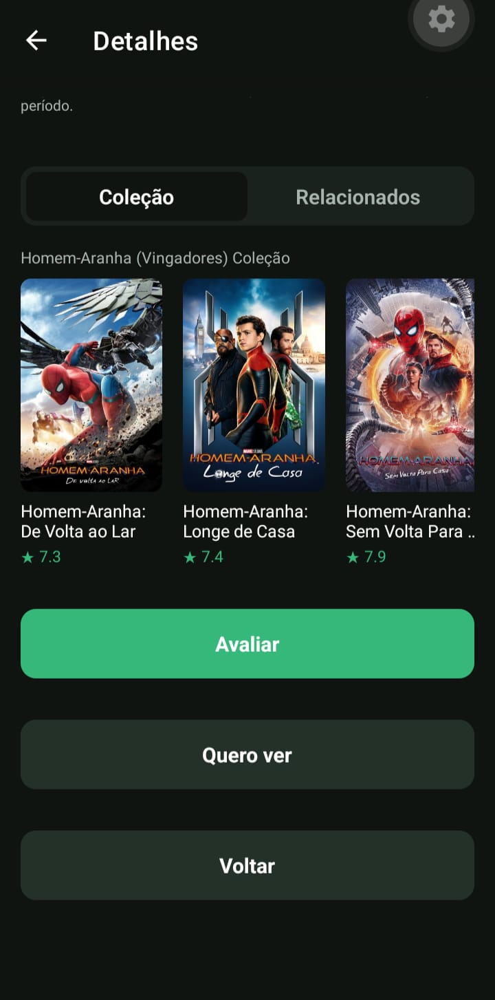<br><sub>Avaliar / Quero ver</sub></td>
    <td align="center">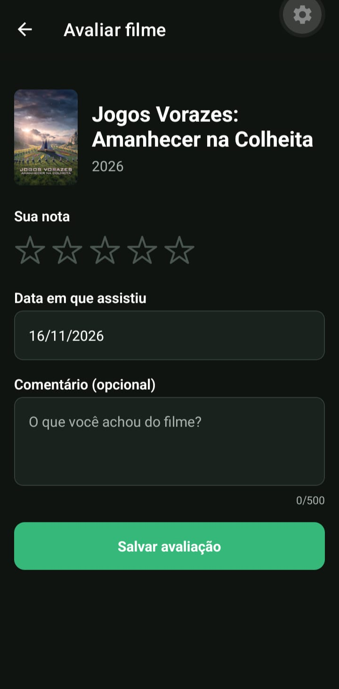<br><sub>Avaliar filme</sub></td>
    <td align="center"><br><sub>Editar avaliação</sub></td>
    <td align="center">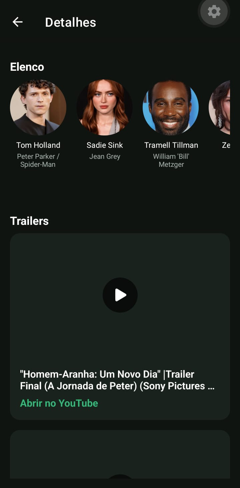<br><sub>Trailers</sub></td>
    <td align="center">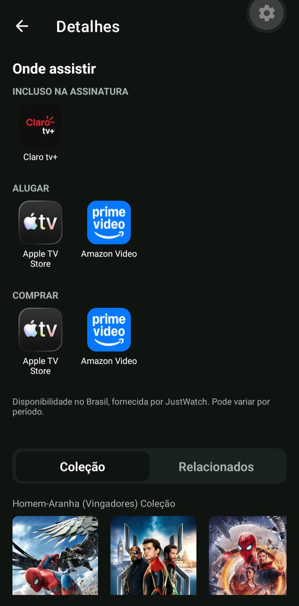<br><sub>Onde Assistir</sub></td>
  </tr>
</table>

### Minha Lista

<table>
  <tr>
    <td align="center"><br><sub>Avaliados</sub></td>
    <td align="center">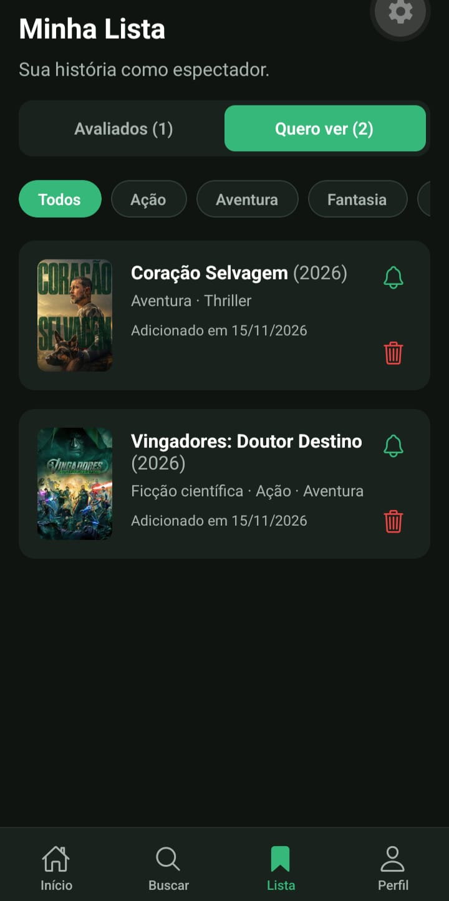<br><sub>Quero ver</sub></td>
    <td align="center"><br><sub>Lembrete</sub></td>
  </tr>
</table>

### Perfil

<table>
  <tr>
    <td align="center">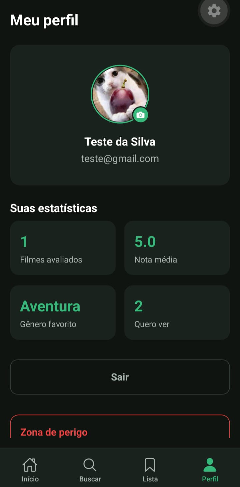<br><sub>Perfil e estatísticas</sub></td>
    <td align="center">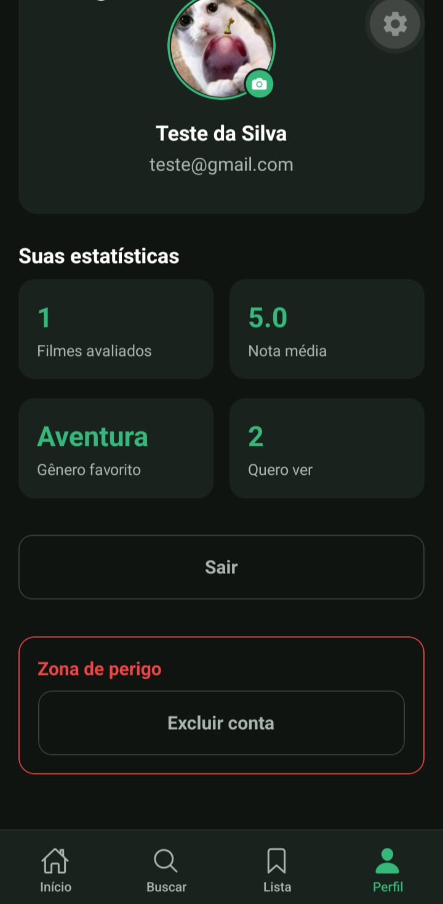<br><sub>Sair e excluir conta</sub></td>
  </tr>
</table>

## Tecnologias

- [React Native](https://reactnative.dev/) e [Expo](https://expo.dev/)
- [React Navigation](https://reactnavigation.org/) (abas e pilha de telas)
- [Firebase](https://firebase.google.com/): Authentication e Firestore
- [TMDB API](https://developer.themoviedb.org/) para o catálogo de filmes
- Expo Image Picker (foto de perfil) e Expo Notifications (lembretes)
- AsyncStorage e `@expo/vector-icons`

## Como executar o projeto

> O app roda em **celular** (Android ou iOS) pelo Expo Go. Esta versão não suporta a web.

### 1. Pré-requisitos

- [Node.js](https://nodejs.org/) **22.13 ou superior** (versão LTS)
- [Git](https://git-scm.com/)
- App **Expo Go** no celular ([Android](https://play.google.com/store/apps/details?id=host.exp.exponent) ou [iOS](https://apps.apple.com/app/expo-go/id982107779)), com o celular na **mesma rede Wi-Fi** do computador
- Uma conta no [Firebase](https://console.firebase.google.com/) e uma chave de API da [TMDB](https://www.themoviedb.org/settings/api)

### 2. Clonar e instalar as dependências

```bash
git clone https://github.com/SEU-USUARIO/FrameRate-ProjetoFinal.git
cd FrameRate-ProjetoFinal/FrameRate
npm install
```

### 3. Configurar o Firebase (chaves de teste)

Existem duas formas de configurar:

**Opção A – usar as chaves de teste do grupo.** O grupo disponibiliza um arquivo `.env` de teste junto com a entrega. Basta salvá-lo em `FrameRate/.env` e pular para o passo 4.

**Opção B – criar o seu próprio projeto Firebase:**

1. No [Console do Firebase](https://console.firebase.google.com/), clique em **Adicionar projeto**.
2. Em **Authentication → Método de login**, ative **E-mail/senha**.
3. Em **Firestore Database**, clique em **Criar banco de dados**.
4. Ainda no Firestore, abra a aba **Regras**, cole o conteúdo do arquivo [`FrameRate/firestore.rules`](FrameRate/firestore.rules) e clique em **Publicar**.
5. Em **Configurações do projeto → Geral → Seus apps**, registre um app **Web** (`</>`) e copie os valores do `firebaseConfig`.

### 4. Criar o arquivo `.env`

Na pasta `FrameRate`, copie o modelo e preencha com as suas chaves:

```bash
cp .env.example .env
```

```env
# TMDB (chave "API Key v3")
EXPO_PUBLIC_TMDB_API_KEY=

# Firebase (valores do firebaseConfig)
EXPO_PUBLIC_FIREBASE_API_KEY=
EXPO_PUBLIC_FIREBASE_AUTH_DOMAIN=
EXPO_PUBLIC_FIREBASE_PROJECT_ID=
EXPO_PUBLIC_FIREBASE_STORAGE_BUCKET=
EXPO_PUBLIC_FIREBASE_MESSAGING_SENDER_ID=
EXPO_PUBLIC_FIREBASE_APP_ID=
```

Sem aspas e sem espaços em volta do `=`. O arquivo `.env` **não vai para o repositório** (está no `.gitignore`).

### 5. Iniciar o app

```bash
npx expo start -c
```

Abra o **Expo Go** no celular e escaneie o QR Code que aparece no terminal (no iPhone, pode ser pela câmera). O `-c` limpa o cache, e vale usá-lo sempre que mudar o `.env`.

Se o celular não encontrar o computador na rede, use `npx expo start --tunnel`.

## Estrutura do projeto

```
FrameRate-ProjetoFinal/
├── docs/screenshots/      # Prints usados neste README
└── FrameRate/
    ├── assets/            # Logo e imagens
    ├── src/
    │   ├── components/    # Componentes reutilizáveis (Screen, AppButton, MovieCard...)
    │   ├── context/       # Estado global (autenticação, avaliações e lista)
    │   ├── navigation/    # Navegação em pilha e em abas
    │   ├── screens/       # Telas: Login, Cadastro, Início, Busca, Detalhes, Avaliar, Lista, Perfil
    │   ├── services/      # Firebase, TMDB, avaliações, lista, usuário e notificações
    │   ├── theme/         # Cores, espaçamentos e tipografia
    │   └── utils/         # Validações e funções auxiliares
    ├── App.js
    ├── app.json
    └── firestore.rules    # Regras de segurança do Firestore
```

## Solução de problemas

| Problema | O que fazer |
|---|---|
| `auth/invalid-api-key` ao abrir o app | O `.env` não existe ou está com valores vazios. Crie-o (passo 4) e reinicie com `npx expo start -c`. |
| "Chave da TMDB ausente" ou erro 401 | Confira `EXPO_PUBLIC_TMDB_API_KEY` e use a **API Key v3**, não o token longo. |
| `Node.js is outdated and unsupported` | Atualize o Node para a versão 22.13 ou superior e abra um terminal novo. |
| `Failed to resolve plugin for module ...` | Faltam dependências instaladas. Rode `npm install` na pasta `FrameRate`. |
| Alterações não aparecem no celular | Pare o servidor e rode `npx expo start -c`. |

## Divisão de tarefas e integrantes

| Integrante | Responsabilidades |
|---|---|
| **Kaio Alexandre** ([@KaioAlexandredeMorais](https://github.com/KaioAlexandredeMorais)) | Integração com a TMDB, identidade visual e documentação |
| **Cauã Yuri** ([@YuriLima999](https://github.com/YuriLima999)) | Integração com o Banco de Dados FireBase, autenticações, criação do cadastro e criação do .env |
| **Pedro Leite** ([@pedroleite-0](https://github.com/pedroleite-0)) | Criação de Avaliações, edição de perfil e criação das categorias |
| **Bruna Santanna** ([@Bruna17042007](https://github.com/Bruna17042007)) | Estruturação do projeto, criação inicial das telas e identidade visual |
| **Luiz Fellipe** ([@luiz543-io](https://github.com/luiz543-io)) | Criação de listas, visualização das avaliações e Pesquisa por categoria  |

## Créditos

Este produto utiliza a API da TMDB, mas não é endossado nem certificado pela TMDB.

